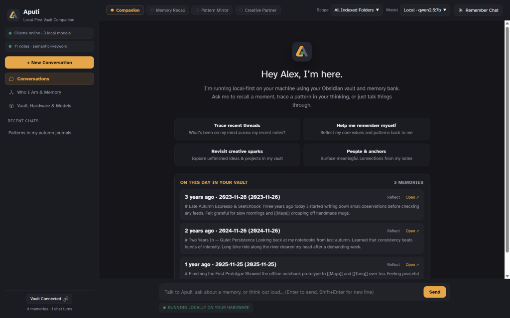
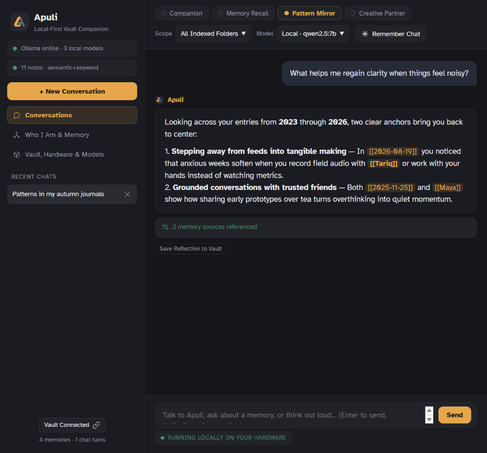
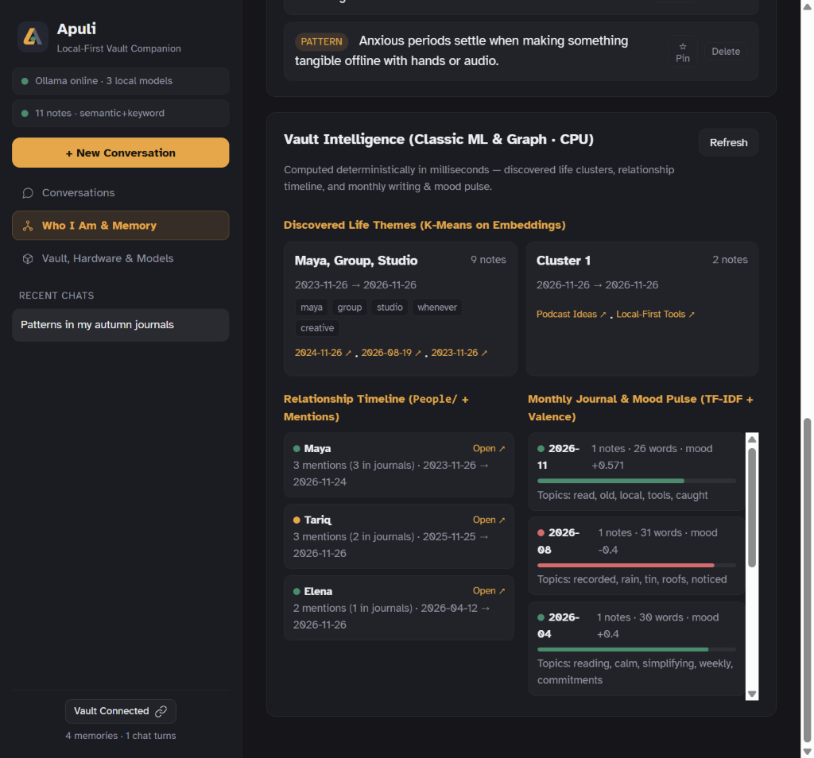

<p align="center">
  
</p>

<h1 align="center">Apuli — Local-First Obsidian Companion</h1>

<p align="center">
  <em>A personal AI &amp; classic ML companion connected to your Obsidian vault — built to talk with you, know you over time, and help you remember yourself.</em>
</p>

Named after what my grandfather used to call me, **Apuli** turns your plain-Markdown Obsidian vault into a living, reflective memory companion. It runs **local-first** on your own hardware using [Ollama](https://ollama.com) plus classic NumPy/SQLite machine learning and graph analytics, keeps your journals and conversations in a private SQLite database on your machine, and optionally lets you plug in frontier cloud APIs or access your PC safely over LAN with a salted PIN lock.

---

## Screenshots

### Companion Chat & "On This Day" Memory Resurfacer


### Cited Obsidian Recall & Pattern Mirror


### Vault Intelligence (Classic ML Clustering, Relationships & Mood Pulse)


---

## Why Apuli?

Most AI chatbots forget who you are between sessions or ask you to upload your private thoughts to someone else's cloud. Your Obsidian vault already holds years of your journals, daily notes, people in your life, creative sparks, and changing perspectives.

Apuli connects directly to your vault on disk so it can:
- **Talk with you** like a grounded companion across four modes (*Companion*, *Memory Recall*, *Pattern Mirror*, *Creative Partner*).
- **Learn as you talk** — quietly distilling enduring values, milestones, relationships, and recurring threads into an editable **Memory Bank**.
- **Remember past conversations** — indexing earlier chats alongside your vault so you can pick up threads weeks later.
- **Evolve your Self-Portrait** — maintaining a living *"Who I Am"* summary grounded in your notes and reflections.
- **Keep you in control** — every retrieved note is cited with an `obsidian://open` link, and folder privacy toggles let you exclude sensitive folders (like password or private vaults) completely.

---

## Key Features

- **Local-First Priority (Ollama):** Works 100% offline with local LLMs and local embeddings (`nomic-embed-text`). Nothing leaves your computer.
- **Classic ML & Graph Vault Intelligence (Zero LLM):** Pure NumPy Spherical K-Means topic clustering (`nomic-embed-text` vectors + TF-IDF labels), `[[wikilink]]` PageRank centrality, `People/` relationship timelines (linked + unlinked mentions), monthly writing/sentiment pulse, and **"On This Day"** memory resurfacing.
- **Two-Tier Monthly Self-Portrait Synthesis:** Reads your vault chronologically with cached per-note digests and cached monthly journal chapters (`synthesis_chapters`), letting a fast VRAM model (e.g. `7B`) digest notes and automatically handing off the final Self-Portrait write to a deeper model (e.g. `14B`) if installed.
- **Hardware Advisor & Tunable Performance:** Automatically detects CPU threads, RAM, and GPU/VRAM, lets you configure CPU parsing threads, Ollama thread caps, embedding batch size, SQLite RAM caching (`mmap` + 64 MB cache), and model `keep_alive` directly in Settings.
- **Optional LAN Access with PBKDF2 PIN Lock:** Run `python run.py --lan` (or toggle in Settings) to open Apuli from your phone/tablet on the same Wi‑Fi behind a salted PBKDF2-SHA256 PIN lock screen with brute-force rate limiting.
- **Optional Frontier AI APIs:** Want to occasionally use **OpenAI**, **Anthropic Claude**, **Google Gemini**, or any **OpenAI-compatible** endpoint (LM Studio, OpenRouter, Groq)? Add your key locally in Settings while keeping vault indexing and embeddings on your machine.
- **Hybrid Obsidian Retrieval + Temporal Query Filter:** Combines SQLite FTS5 keyword search, local vector cosine similarity, deterministic date-window extraction (`"April 2023"`, `"last month"`, `"in 2024"`), and PageRank-weighted 1-hop `[[wikilink]]` graph expansion.
- **Live Vault Sync (Read-Only):** Scans on startup and watches your Obsidian folder with `watchdog` (~1.5s debounce) without ever altering your existing vault notes unless you explicitly click *Save Reflection to Vault*.
- **Zero-CDN Offline Web UI & Fonts:** Bundled dark-theme UI with offline fonts (*Atkinson Hyperlegible*, *Source Code Pro*, *Literata*, *IBM Plex Serif*, or any installed system font) served locally on `http://127.0.0.1:8420`.

---

## Quickstart

### Prerequisites
- **Python 3.10+**
- **[Ollama](https://ollama.com)** installed (recommended for local-first operation)
- An **Obsidian Vault** folder on your computer

### 1. Clone & Install

```bash
git clone https://github.com/ApurboTheA1/apuli.git
cd apuli
```

**Windows:**
```powershell
python -m venv .venv
.\.venv\Scripts\python.exe -m pip install -r requirements.txt
```
Then double-click `start.bat` or run:
```powershell
.\.venv\Scripts\python.exe run.py
```

**macOS / Linux:**
```bash
chmod +x start.sh
./start.sh
```

### 2. Connect Your Vault
1. Your browser opens automatically at `http://127.0.0.1:8420`.
2. On first run, enter your name and your Obsidian vault path (Apuli also checks common Obsidian folders automatically).
3. Open **⚙️ Vault, Hardware & Models** to:
   - See the local Ollama models recommended for your hardware and pull one in 1 click.
   - Pull `nomic-embed-text` (~274 MB) for semantic meaning search alongside keyword search.
   - Choose which vault folders Apuli can read (`.obsidian` and `.trash` are always excluded).

---

## Hardware Guide

Apuli inspects your system locally and recommends a tier automatically:

| Hardware Tier | Typical Specs | Suggested Local Models |
| :--- | :--- | :--- |
| **Lightweight** | ~8 GB RAM, CPU / iGPU | `llama3.2:3b`, `qwen2.5:3b` |
| **Balanced** | 16 GB+ RAM or 6–8 GB VRAM | `qwen2.5:7b`, `dolphin-llama3:8b`, `llama3.1:8b`, `deepseek-r1:7b` |
| **Performance** | 32 GB+ RAM & 12 GB+ VRAM / Apple Silicon 24 GB+ | `qwen2.5:14b`, `deepseek-r1:14b`, `dolphin-llama3:8b` |

> **Tip — Unfiltered Voice + Accurate Memory:** Want candid, non-preachy conversations without sacrificing structured memory extraction? Chat with a low-refusal model like `dolphin-llama3:8b` and set **Background Memory Model** in Settings to `qwen2.5:7b` (or `qwen2.5:14b`) so memory distillation and Self-Portrait synthesis stay sharp.

*(If you have no local GPU or want cloud frontier reasoning on a specific question, configure an optional API key under **Optional Frontier AI APIs** in Settings — API keys stay strictly inside your local `data/config.json`, which is gitignored.)*

---

## Architecture

```text
Obsidian Vault (.md files)
   │  (watchdog live sync + frontmatter/[[wikilink]]/#tag parser)
   ▼
SQLite + FTS5 + Float32 Vector Cache  (data/companion.db — 100% local)
   ├── notes & chunks         (Obsidian vault knowledge)
   ├── chat_chunks            (Cross-chat recall across sessions)
   ├── memories               (Auto-distilled & user-pinned insights)
   └── self_profile           (Evolving "Who I Am" Markdown portrait)
   │
   ▼
Hybrid Retriever (Semantic + BM25 + Recency + [[Link]] Graph)
   │
   ▼
Local-First Model Router
   ├── Primary: Local Ollama (localhost:11434)
   └── Optional: OpenAI / Anthropic / Gemini / Custom OpenAI-Compatible
   │
   ▼
FastAPI SSE Server + Offline Web UI (http://127.0.0.1:8420)
```

---

## Privacy Guarantee

- **Your notes never leave your disk** when using local Ollama models.
- All indexes, chat transcripts, distilled memories, and API keys live inside `data/` (`companion.db` and `config.json`), which is excluded from Git via `.gitignore`.
- Folder toggles let you exclude sensitive folders at any time, and deleting a folder exclusion immediately purges its indexed chunks.

---

## Running Tests

```bash
pytest -v
```

---

## License

[MIT](LICENSE)
